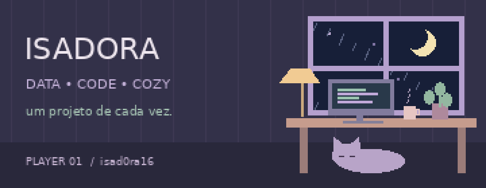
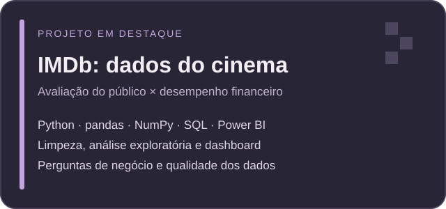
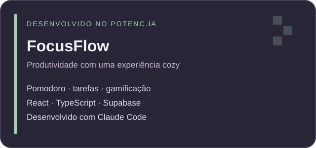

## 💜 Oi, eu sou a Isadora!

**Formada em Farmácia · estudante de Ciência da Computação · Análise e Engenharia de Dados · rumo à Engenharia de IA**

### 🧭 Sobre mim

🎓 Curso **Ciência da Computação**, atualmente no **4º período**.

🔬 Minha formação em **Farmácia** faz parte da minha trajetória: levo para os projetos o cuidado com informações e o interesse em investigar evidências.

📊 Hoje construo minha base em **Análise e Engenharia de Dados**, com **Engenharia de Inteligência Artificial** como objetivo de longo prazo.

🌱 Estou construindo meu portfólio com **Python, SQL e Power BI**, enquanto aprofundo meus estudos em bancos de dados, ETL e modelagem.

🤖 No desenvolvimento de software, trabalho com **Claude Code, agentes e skills** para planejar, implementar e testar em etapas pequenas, revisando e decidindo cada passo.

🎮 Gosto de jogos, séries e filmes. Por aqui, essa criatividade aparece em projetos e em uma estética lo-fi/cozy — café virtual sempre disponível. ☕

## 💼 O que desenvolvo nos meus projetos

▸ **Preparação de dados:** limpeza, padronização, tratamento de ausências e duplicidades.

▸ **Análise exploratória:** investigação de padrões, comparação entre grupos e estatística descritiva.

▸ **SQL e bancos relacionais:** consultas, joins e agregações para explorar informações.

▸ **Dashboards:** visualização e comunicação de resultados com Power BI.

▸ **Aplicações web com IA:** React, TypeScript e Supabase, desenvolvidos com Claude Code.

▸ **Documentação:** explicação das decisões técnicas, do tratamento dos dados e dos limites das análises.

## 🤝 Vamos nos conectar!

Gosto de trocar ideias sobre dados, inteligência artificial, tecnologia e transição de carreira.

---

## 📚 O que estou estudando agora

| Em andamento | Foco |
| --- | --- |
| Ciência da Computação (Descomplica) | Formação em computação e desenvolvimento da base técnica. |
| Indicium Academy | Trilhas de Análise de Dados e Engenharia de Dados. |
| Potenc.IA (MCIO Brasil) | Inteligência artificial aplicada. |
| Google Data Analytics | Processo de análise e comunicação com dados. |
| AWS Cloud Practitioner (Fundamentals) | Preparação para a certificação: fundamentos de nuvem. |

---

## 🗂️ Projetos em destaque

<table>
<tr>
<td width="50%" valign="top">

<h3>🎬 <a href="https://github.com/isad0ra16/analise-imdb">IMDb</a></h3>

Investigação da relação entre <b>nota, orçamento e receita</b> de filmes, orientada por perguntas de negócio, no desafio de dados da comunidade First Commit-m.

Preparação com Python, pandas e NumPy, exploração com SQL no Databricks e apresentação em um dashboard de quatro páginas no Power BI.

<b>Destaque:</b> regras de triagem para receitas e orçamentos inconsistentes e atenção à diferença entre padrões observados e conclusões comprovadas.

</td>
<td width="50%" valign="top">

<h3>🍃 <a href="https://github.com/isad0ra16/Focus-Flow">FocusFlow</a></h3>

App web de foco que combina <b>Pomodoro, tarefas e gamificação</b> com uma experiência inspirada em <b>cozy games e pixel art</b>. Desenvolvido no Potenc.IA.

React, TypeScript e Supabase (Postgres com Row Level Security), construído com Claude Code em etapas pequenas, com testes em Vitest e Playwright.

<b>Destaque:</b> player isolado por segurança, regras de acesso testadas com duas contas e transparência sobre o que já foi testado de verdade. Código-fonte privado · <a href="https://focusflow-teste.pages.dev/">abrir o protótipo</a>.

</td>
</tr>
</table>

---

## 🛠️ Skills & ferramentas

Ferramentas que utilizo nos estudos e projetos:

**Na prática:** limpeza de dados · análise exploratória · consultas SQL · estatística descritiva · dashboards · documentação · desenvolvimento web assistido por IA.

**Em aprofundamento:** ETL · pipelines · modelagem de dados · fundamentos de cloud · IA aplicada.

---

## 🎯 Para onde estou indo

Meu objetivo é me tornar **Engenheira de Inteligência Artificial**. Dados são a base desse caminho.

**Próximos passos:**

- Concluir as trilhas de Análise e Engenharia de Dados (Indicium Academy)
- Conquistar a certificação AWS Cloud Practitioner (Fundamentals)
- Construir um pipeline de dados de ponta a ponta: extração, transformação em Python, banco de dados e dashboard
- Desenvolver projetos de IA aplicada que usem dados reais
- Seguir aprofundando o desenvolvimento de software assistido por IA, como no FocusFlow

---

  
<i>Aprendendo, construindo e compartilhando — um projeto de cada vez.</i>
  

 
Obrigada pela visita ao meu cantinho. ☕🌿

<!--
PUBLICAÇÃO
Envie README.md e a pasta assets para a raiz do repositório público isad0ra16/isad0ra16.
Preserve os nomes dos arquivos para que GIFs e cards apareçam.
VISITORS contabiliza visualizações, não pessoas únicas.
-->
