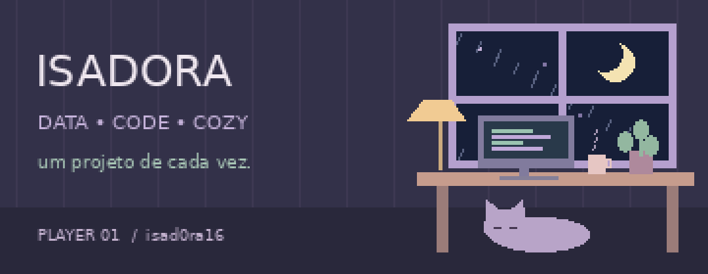
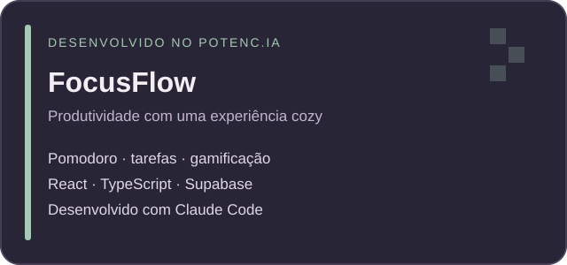
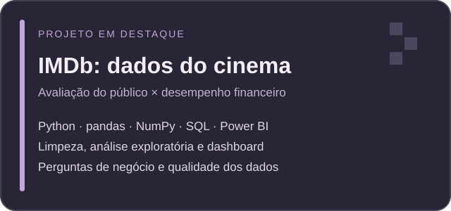

## 💜 Oi, eu sou a Isadora!

**Estudante de Ciência da Computação · Cloud & Infraestrutura · Inteligência Artificial Aplicada · Desenvolvimento de Software**

### 🧭 Sobre mim

🎓 Estou no **4º período de Ciência da Computação** e sou formada em **Farmácia (2021)**. Minha experiência anterior me ensinou a investigar problemas, trabalhar com informações sensíveis, comunicar ideias e transformar conhecimento técnico em soluções úteis.

☁️ Atualmente, amplio minha formação em **computação em nuvem, infraestrutura, desenvolvimento de software e inteligência artificial aplicada**. Tenho interesse em entender tanto como as aplicações são construídas quanto a infraestrutura que permite executá-las.

🧩 Gosto de aprender construindo: aplicações web, automações, exploração de dados e projetos que conectam tecnologia a problemas reais. Tenho experiência de estudo e projetos com **Python, SQL, React, TypeScript, Supabase e ferramentas de análise de dados**.

🎮 Fora do código, gosto de jogos, séries, filmes e de tudo que tenha uma estética *cozy*. Por isso, este GitHub tem um pouquinho de pixel art e café virtual. ☕

## 💼 O que você encontra por aqui

▸ **Software e aplicações:** interfaces web, lógica de programação, integração com bancos de dados e testes.

▸ **Cloud e infraestrutura:** estudos de fundamentos de AWS, serviços em nuvem e conceitos de infraestrutura.

▸ **IA aplicada:** aprendizado de máquina, experimentação e interesse em aplicações inteligentes e automações.

▸ **Dados:** preparação, análise exploratória, SQL, indicadores e visualização para apoiar decisões.

▸ **Boas práticas:** versionamento com Git, documentação, investigação de problemas e validação de resultados.

## 🤝 Vamos nos conectar!

Gosto de trocar ideias sobre tecnologia, cloud, infraestrutura, IA e projetos criativos.

---

## 📚 Minha jornada de aprendizado

| Formação / curso | Área | Situação |
| --- | --- | --- |
| Ciência da Computação — Descomplica | Fundamentos de computação e desenvolvimento | Em andamento |
| Escola da Nuvem — AWS | Fundamentos de cloud e infraestrutura | Em formação |
| IBM AI Engineering — Coursera | Inteligência artificial e machine learning | Em andamento |
| IBM — Desenvolvimento de Software Full Stack | Desenvolvimento de aplicações | Em andamento |
| Potenc.IA — MCIO Brasil | Tecnologia e IA aplicada | Formação complementar |

*As formações em andamento não representam certificações já obtidas.*

---

## 🗂️ Projetos em destaque

<table>
<tr>
<td width="50%" valign="top">

<h3>🍃 <a href="https://focusflow-teste.pages.dev/">FocusFlow</a></h3>

Aplicação web de produtividade que reúne <b>Pomodoro, tarefas e gamificação</b> em uma experiência inspirada em cozy games e pixel art.

<b>Tecnologias:</b> React, TypeScript, Supabase/PostgreSQL. O projeto inclui atenção a regras de acesso, segurança e testes.

<b>Destaque:</b> integração entre interface, lógica de aplicação e persistência de dados. <a href="https://focusflow-teste.pages.dev/">Ver protótipo</a> · código-fonte privado.

</td>
<td width="50%" valign="top">

<h3>🎬 <a href="https://github.com/isad0ra16/analise-imdb">IMDb Analytics</a></h3>

Projeto de investigação de dados cinematográficos, relacionando <b>avaliações, orçamento e receita</b> com perguntas de negócio.

<b>Tecnologias:</b> Python, pandas, NumPy, SQL, Databricks e Power BI.

<b>Destaque:</b> tratamento de inconsistências, exploração de dados e apresentação de indicadores em dashboard.

</td>
</tr>
</table>

### 🏥 Hospital Analytics — dados públicos de saúde

Projeto com dados do **SIH/DATASUS**, voltado à coleta, auditoria e preparação de informações hospitalares. Inclui investigação de duplicidades, análise de indicadores e tratamento de dados com Python. **O dashboard interativo em Power BI é uma entrega planejada**, não uma etapa apresentada como concluída.

---

## 🛠️ Tecnologias e ferramentas

**Desenvolvimento e versionamento**

**Banco de dados e análise**

**Em aprendizado e aprofundamento**

---

## 🎯 Próximos passos

Quero desenvolver uma carreira que conecte **infraestrutura, cloud, engenharia de software e IA aplicada**, mantendo espaço para explorar como essas áreas se complementam.

- Consolidar fundamentos de **AWS, redes, sistemas e infraestrutura**.
- Aprofundar conhecimentos em **desenvolvimento Full Stack**, testes e arquitetura de aplicações.
- Criar projetos que integrem **aplicações, serviços em nuvem e automação**.
- Evoluir meus estudos de **machine learning e IA aplicada** com experimentos documentados.
- Continuar desenvolvendo e publicando projetos com escopo, decisões técnicas e limitações bem explicados.

---

  
<i>Aprendendo, construindo e compartilhando — um projeto de cada vez.</i>
  

 
Obrigada pela visita ao meu cantinho. ☕🌿

<!--
PUBLICAÇÃO
Substitua o README.md do repositório de perfil isad0ra16/isad0ra16 por este arquivo.
Mantenha a pasta assets original para preservar os GIFs e cards.
VISITORS contabiliza visualizações, não pessoas únicas.
-->
